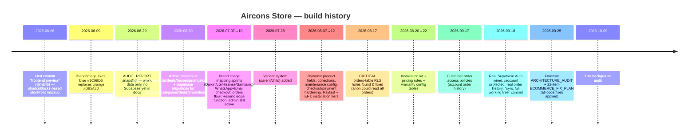

# 04 — Historical Context

## Timeline reconstructed from git + docs

## Who built it

- Author `Sim846 <simbachivas98@gmail.com>` (first commits), then `Airconsstore3 <airconsstore3@gmail.com>` — INFERRED same person (commit `2763f99` "fix author").
- INFERRED: AI-assisted throughout (vibe-coding pattern: rapid same-day micro-commits, audit docs, no co-authors). Which AI tool: UNKNOWN — no `Co-Authored-By` trailers; `AGENTS.md` + `skills-lock.json` (Supabase agent skills installed) indicate agent-driven development in this workspace.
- Single-person project; no contractors visible in history.

## Major milestones

1. **Frontend prototype** (June 6–29) — shadcnblocks/`SHADCNBLOCKS_API_KEY` licensed components; mock data.
2. **CMS-ish admin + Supabase schema** (June 30) — products/categories/deals/promotions/heroes/settings tables + full admin UI.
3. **Commerce engine** (July 10) — orders/order_items/payments, WhatsApp checkout, Resend notifications.
4. **Variants** (July 28) — parent/child model.
5. **Payment hardening** (Aug 12–22) — Payfast, EFT, installation tiers, kits, warranties, security hardening.
6. **RLS incident & fix** (Aug 17) — two critical anon-read holes on orders.
7. **Customer auth** (Sept 17–18) — Supabase Auth, /account order history.
8. **Audit & fix wave** (Sept 25) — 22 fixes; admin panel absent by this point.

## Rebuilds / pivots / removals

- **Admin panel built then deleted** (June 30 → gone by Sept 25 audit "there is no admin UI in this repo"). `nextadmin-template/` (node_modules only) suggests a replacement attempt abandoned. Reason UNKNOWN — possibly a "restore" (backup branches exist).
- **Mock-data phase → real Supabase** — `mock-data.ts` / `mock-products.ts` remain as dead code.
- **CoolAir → Aircons Store rebrand** — root metadata once said "CoolAir — Cape Town" (fix-plan item #17).
- **Orange → blue rebrand** — `#D85A30` → `#1C99D6` (commit `34ac34f`).
- **Backup branches** — `backup-full-website-before-restore`, `backup-homepage-before-restore` imply at least one restore event mid-build.
- **Deprecated/stale docs** — `AUDIT_REPORT.md` (pre-Supabase era), `ADMIN_SETUP_GUIDE.md` (admin deleted).

## Deprecated features still in tree

- `src/lib/mock-data.ts`, `src/data/mock-products.ts` — dead code.
- `mapSupabaseProductToVariant` — unused.
- `scripts/` — migration/seed one-offs (keep for provenance).
- `supabase-migration-variants.sql` — root-level stray migration.
- `nul` file at repo root — Windows artefact.
