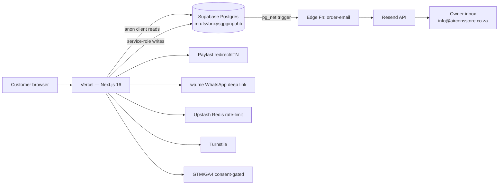

# 05 — Technical Context

## Stack and rationale (inferred where not documented)

| Choice | Evidence | Rationale |
|---|---|---|
| Next.js 16 App Router + RSC + Server Actions | `package.json`, app dir | INFERRED: AI-tool default; single-deploy full-stack, server actions avoid writing an API layer |
| TypeScript + Zod validation | tsconfig, `checkout/actions.ts` | Type-safe pricing/order contracts |
| Tailwind v4 + shadcn/ui + Radix + Relume + shadcnblocks | `components.json`, `SHADCNBLOCKS_API_KEY`, deps | Fast UI assembly; premium blocks licensed |
| Supabase Postgres (data + Auth + Edge Fn + pg_net) | `supabase/` | INFERRED: zero-backend-ops Postgres with RLS, Auth and functions in one service |
| Service-role client for all order writes | `src/lib/supabase-service.ts` | Bypasses RLS for writes while anon reads stay RLS'd |
| Manual EFT + Payfast | `src/lib/payment/` | SA market fit: EFT ubiquitous; Payfast is the default ZA gateway. No Stripe/Adyen anywhere |
| Resend for transactional email | `order-email` edge fn | Simple HTTPS API, works from Deno edge functions |
| Upstash Redis rate-limiting | env vars, `AGENTS.md` | Serverless-friendly rate limiting, graceful skip |
| Cloudflare Turnstile | env vars | Free CAPTCHA, optional |
| Vercel hosting | commits + README | INFERRED |
| Provider registry pattern (`registry.ts` separate from providers) | `AGENTS.md` rationale | Avoids ESM temporal-dead-zone on side-effect imports — documented |

## Architecture summary

## Strengths

- Server-side price resolution; client prices never trusted.
- Token-gated order reads (`secure_token` + UUID validation + 48h expiry).
- Layered Payfast ITN verification (signature, IP allowlist, server-side validate, merchant match).
- Idempotency key on orders; rate limiting; CAPTCHA; compensation on partial insert failure.
- Phone normalization unit-tested (13/13 vitest).

## Known tech debt & origins

| Debt | Origin |
|---|---|
| No admin UI (deleted) | Built June 30, removed by Sept — admin tasks now manual SQL/dashboard |
| Inventory cosmetic (`stock_count` never decremented) | Checkout MVP scope |
| `variant_id` never populated on order items | Variant system added after checkout |
| Fake ratings generator | Placeholder social proof never replaced by real reviews system |
| Mock subscriptions/warranties account pages | Feature scaffolding shipped before backend existed |
| Dead forms (newsletter, maintenance booking) | UI shipped ahead of backend |
| Dead code files, stray SQL at root, `nul` file | AI-commit hygiene |
| Deal price ≠ checkout price | Deals modelled separately from products without price plumbing |
| 15 `set-state-in-effect` lint errors | Legit patterns needing `useSyncExternalStore` refactor |
| `orders.items` JSONB duplication vs `order_items` rows | Dual-write convenience |
| Integer-rand money (no cents) | Simplification — fine for big-ticket items |
| Payfast amount `Math.round` tolerance ±R0.49 | Float formatting in gateway params |

## Half-finished features

- `/enquire` page (built July — `885ef2b`) — no longer in route tree (INFERRED folded into product enquiry flow or lost in restore).
- Collections breadcrumb 404s fixed; `/collections` sitemap entries missing.
- Settings table fields (`free_shipping_threshold_zar`, `announcement_*`) not wired to checkout totals.
- Email webhook only notifies on `email|both` channel — WhatsApp-only orders rely on customer opening WhatsApp.
