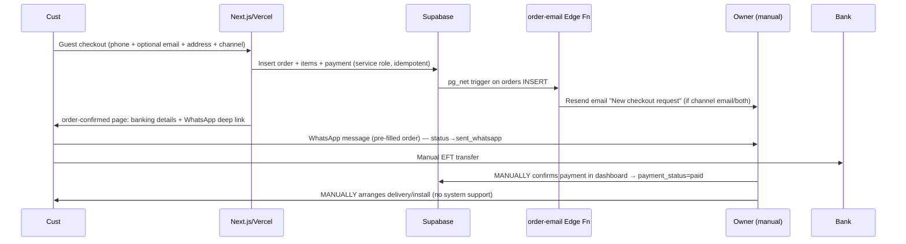

# 07 — Operational Context

## Who runs the store day-to-day

- INFERRED: a single owner-operator (commit author Sim846/Airconsstore3). Owner notifications go to `OWNER_EMAIL` env or `info@airconsstore.co.za`; business WhatsApp `+27767100588` (set via migration).
- No admin UI → **all order operations happen in the Supabase dashboard + WhatsApp/email inboxes**.

## Order processing workflow (as implemented)

## Fulfilment

- **UNKNOWN — needs founder confirmation**: delivery method, zones, courier partners, installer scheduling. No fulfilment states exist beyond `paid`.
- Address fields collected on orders; no shipping cost or courier integration.

## Customer support

- Channels offered: WhatsApp (`wa.me` links — some still placeholder `27000000000`), email aliases (`info@`, `support@`, `privacy@`), phone placeholders.
- `/help` (help2 component) + `/warranty` claim flow descriptions — but warranty registration/claim forms' backend UNKNOWN (page is largely informational).
- `/repairs` and `/maintenance` pages — the maintenance booking form is **front-end only** (submits to nowhere).

## Returns & refunds workflow

- Policy page exists (CPA-aligned language); **no operational workflow** — returns/refunds handled manually, if at all. No refund states in order model.

## Inventory management

- `stock_count`/`is_sold_out` maintained manually (presumably in dashboard); never decremented on sale → overselling possible by design.

## Marketing channels in use

- WhatsApp (primary), email (Resend transactional only — no marketing platform), GTM/GA4 (consent-gated), Google Ads conversion tracking implied by consent copy, `/deals` + promotions/heroes CMS tables, staged Trustpilot assets.
- Newsletter capture exists visually but emails go nowhere (dead form).

## Tooling summary

| Function | Tool |
|---|---|
| Storefront/hosting | Vercel (inferred) |
| DB/Auth/Functions | Supabase |
| Email | Resend |
| Chat | WhatsApp Business (`+27767100588`) |
| Analytics | GTM + GA4 |
| Rate limiting | Upstash Redis |
| CAPTCHA | Cloudflare Turnstile |
| Order admin | Supabase dashboard (manual) |
