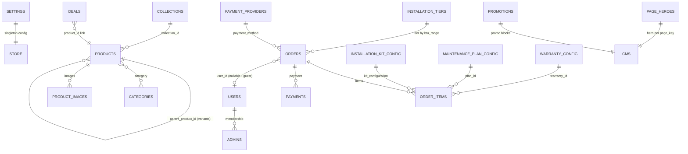

# 12 — Domain Model

## Entity-relationship overview

## Core entities and business rules

### Product
- Fields: `id`, `slug`, `name`, `display_name`, `description`, `price_zar` (integer rand), `category`, `brand`, `btu_range`, `available_btu_sizes`, `is_parent_product`, `parent_product_id`, `variant_attributes` JSONB, `is_published`, `is_sale`, `is_deal`, `stock_count`, `is_sold_out`, SEO fields, `meta_*`, `updated_at`.
- Rules:
  - Variants are products with `parent_product_id` → parent; parents render variant selectors.
  - Only `is_published` products appear in sitemap/storefront.
  - `is_sold_out` rejects the item at server-side pricing — but `stock_count` is never decremented (no reservation model).
  - `variant_attributes` keys are dynamic (btu, phase, model…) — open-ended attribute model.

### Order ("checkout request")
- Fields: `id`, `order_number`, `secure_token` (UUID), `idempotency_key`, `name`, `phone` (+27 normalized), `email?`, `notes?`, delivery address fields, `channel` (whatsapp|email|both), `status` (`submitted`→`sent_whatsapp`/`email_sent`→`paid`), `payment_method` (manual_eft|payfast), `payment_status`, `paid_at`, `provider_transaction_id`, pricing totals (subtotal/installation/kit/maintenance/warranty/total _zar), `items` JSONB (denormalized copy), `expires_at` (48h), `user_id?`, `whatsapp_url`.
- Rules:
  - Guest orders allowed; phone is primary identifier.
  - Read access only via valid `secure_token` (service role) or admin/auth policies.
  - `expires_at` gates confirmation page — waived for pending manual_eft (banking details must remain visible).
  - Status vocabulary is channel-oriented, NOT fulfilment-oriented — no shipped/delivered/refunded states.
  - Prices come only from `resolveOrderPricing()` — client totals ignored.

### OrderItem
- `order_id`, `product_id`, `name`, `quantity`, `unit_price_zar`, `line_total_zar`, `variant_id` (never populated), plus configuration fields (installation tier, kit config, plan, warranty).
- INFERRED inconsistency: item data lives twice — `order_items` rows AND `orders.items` JSONB.

### Payment
- Linked to order; Payfast `m_payment_id`/ITN updates; manual EFT confirmed by human edit.

### Customer/User
- Supabase Auth user (email/password); `/account` shows order history, profile (contact_method preference), subscriptions + warranties (mock data pages).

### Settings (singleton)
- `store_name`, `contact_email`, `contact_phone`, `whatsapp_number`, `bank_*` EFT fields, `free_shipping_threshold_zar`, `announcement_*`. Read restricted to `admins` members (post-20260925 migration).

### Admins
- `admins(user_id)` table — membership grants settings read; no UI to manage membership.

### CMS entities
- `page_heroes` (per page_key), `promotions`, `deals` (optional `product_id` link), `categories`, `collections`.

## Terms used inconsistently

| Term A | Term B | Where | Issue |
|---|---|---|---|
| "Aircons Store" | "Airconsstore" | layout vs terms page | Brand/legal naming |
| "order" | "checkout request" / "quote request" | code vs edge fn vs privacy page | Same entity, three labels — affects policy wording (is it a sale or a quote?) |
| "deal" | "sale" / "promotion" | `is_deal`/`is_sale`/deals/promotions | Overlapping promotion concepts; deal price ≠ charged price |
| "variant" | "size" / "available sizes" | DB vs PDP UI | BTU-as-variant displayed as sizes |
| "subscription" | "maintenance plan" | `/account/subscriptions` (mock) vs `maintenance_plan_config` | Same commercial concept, two names |
| "customer" | "user" / guest | auth vs orders | Account optional; phone is the real key |
| domain `airconsstore.co.za` | `aircons-store.co.za` | legal pages vs Resend sender default | Possible domain mismatch for email |
