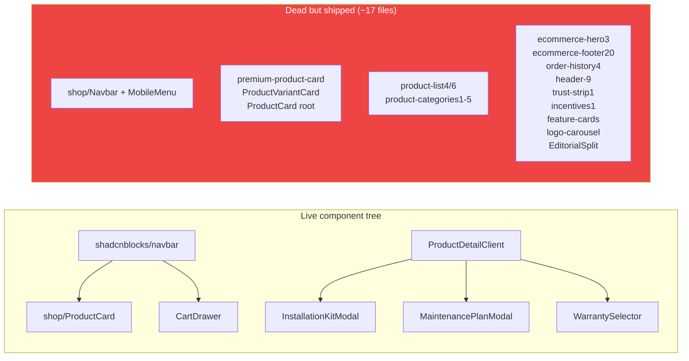

# 01 — Design Audit (Evidence-Based)

Every finding cites file paths, component names, class names or line numbers. Facts are facts; anything inferred is labelled **[ASSUMPTION]**.

---

## 1. Brand foundation

### 1.1 Logo
- **Wordmark in nav:** SVG image `/Logo.svg` rendered at `h-24` (96px) desktop / `h-[4.5rem]` mobile inside `src/components/shadcnblocks/navbar.tsx:391-404`. A 96px logo inside an 8rem (128px) sticky header consumes ~13% of a 768px viewport before any content.
- **Alt logos exist but are unused:** `public/aircon store logo.svg` (used only in footer, `premium-footer.tsx:106`), `public/Aircons Store.svg`, `src/Aircons logo 2.svg`. Three logo files, no guidance on which is canonical.
- **Text fallbacks:** dead `src/components/shop/Navbar.tsx:57` renders "Aircons Store" in Poppins; login form renders "Airconsstore" (one word, different casing — `login-form.tsx:25`); mobile drawer renders "AIRCONS STORE" uppercase in Google Sans Flex (`navbar.tsx:297`).
- **Logo variants/clear-space rules:** MISSING — not implemented.
- **Finding:** 4 different logo renderings (SVG image, Poppins text, "Airconsstore", uppercase drawer text). **Severity: High.**

### 1.2 Color palette (as implemented)
Three palettes coexist. Full token inventory in `02-design-tokens-as-is.md`.

**Brand palette (globals.css `:root`):** navy `#0A2540`, blue `#1C99D6`, light blue `#D7F0FC/#E6F5FD/#F0F9FF`, border `#B8E3F7`.
**Stale palette B (auth/order/error/footer/drawer):** navy `#1E3A5F`, drawer navy `#16324F`, warm gray `#FAFAF9`, grays `#6B7280/#9CA3AF`.
**Relume namespace (globals.css:51-64):** pure `#000`/`#fff`/`#666`/`#aaa` — semantically named tokens that contradict the brand ramp.

- Hardcoded brand hexes appear in **~60 files / ~1,651 occurrences** — the tokens are defined but bypassed.
- **Finding: Critical inconsistency.** `#0A2540` vs `#1E3A5F` vs `#16324F` are three different navies; a customer moving PDP → checkout → order-confirmed crosses two of them. **Severity: High.**

### 1.3 Typography
- **Families loaded:** Inter (`next/font`, body), Poppins (`next/font`, `--font-poppins`, used only in dead `Navbar.tsx`), Google Sans Flex (local variable font, `--font-google-sans-flex`, used for headings/logo/homepage/footer/drawer). **Poppins ships to every page but is effectively dead weight.**
- **Scale (nominal, from globals.css comments):** H1 72/40px, H2 56/32px, H3 24/20px, body 16px, button 14px — enforced via `main h1/h2/h3 { !important }` (globals.css:93-105) plus a second competing `.homepage-typography` scale (globals.css:140-213) plus an inline `<style>` in `ProductDetailClient.tsx:1019-1027` forcing `data-product-title` to 30/34/40px and `data-section-title` to 24/26/28px.
- **Result:** the same `h2` = 56px on most pages, but a *different* clamp inside `.homepage-typography`, and 28px on the PDP. Three h2 scales depending on ancestor.
- **Arbitrary sizes everywhere:** `text-[10px]` (nav links), `text-[11px]`, `text-[12px]`, `text-[13px]`, `text-[14px]`, `text-[15px]` — the declared 14/16 system is ignored in practice.
- **Finding: High.** No single type scale is authoritative; `!important` is used as the arbitration mechanism.

### 1.4 Voice & tone
- Copy is functional and plain ("Complete your order securely. No account required.", "Final total is calculated securely from current prices when you checkout."). No brand voice documented — MISSING.
- Inconsistencies: "Aircons Store" vs "Airconsstore"; "Checkout" vs "Place order" vs "Pay securely"; "Price TBC" on enquiry items.
- **Severity: Medium.**

### 1.5 Personality
- Homepage tries for premium-minimal (large Google Sans Flex headings, tight tracking, angled-corner "aircon-angled-button" motif — globals.css:256-336). Commerce surfaces (cart/checkout/auth) are default-shadcn-neutral with `rounded-none` overrides. The angled-border motif appears only on hero CTAs and nav hovers — an under-used distinctive asset.
- **Severity: Medium.**

### 1.6 Storefront vs admin consistency
- **Admin is MISSING — not implemented.** `nextadmin-template/` contains only `node_modules`. Cannot audit consistency.

---

## 2. Visual design

### 2.1 Contrast
- `#1C99D6` on `#FFFFFF` ≈ **3.0:1** — fails AA for the 14px link/price text it is used for (e.g., `CartDrawer.tsx:78` "Continue Shopping", `ProductDetailClient.tsx:1135` price, footer hovers).
- White on `#1C99D6` ≈ **3.0:1** — fails AA for 14-15px CTA text (`bg-[#1C99D6] text-white` in cart/checkout/PLP pagination).
- `#9CA3AF` on white ≈ **2.5:1** — used for footer legal links, trash icons, muted meta text.
- `#5F6B7A` on white ≈ **4.9:1** — passes.
- **Severity: High** (primary action + price color fails).

### 2.2 Hierarchy & readability
- Nav links render at `text-[10px] xl:text-xs` uppercase (`navbar.tsx:450`) — 10px is below every readability guideline for a primary nav.
- Dense PDP buy column is well-structured (brand → h1 → stock/rating → price → tabs → facts → selectors → add-ons → CTA) — the best hierarchy in the app.
- **Severity: Medium** (nav), PDP: pass.

### 2.3 Spacing & alignment
- Tailwind 4px scale used loosely; arbitrary values frequent (`pt-[220px]`, `md:pt-[180px]` to clear the 128px nav — cart/checkout/order-confirmed all hand-tune the same offset instead of using `--secondary-nav-height` consistently).
- Container widths vary: `max-w-6xl` (cart/checkout), `max-w-3xl` (order-confirmed), `max-w-2xl` (empty states), `max-w-[1280px]` (PLP hero), `md:max-w-[95%]` (footer). No single container token.
- **Severity: Medium.**

### 2.4 Grid & layout
- Cart/checkout share `lg:grid-cols-[1.7fr_1fr]` — consistent with each other.
- PLP grid columns are a runtime toggle (3 or 4) with fake pagination beneath.
- **Severity: Low.**

### 2.5 Radius / elevation
- `--radius: 0.5rem` exists, but commerce surfaces force `rounded-none` (checkout inputs, cart/checkout CTAs, variant chips are `rounded-[4px]`), auth cards are `rounded-2xl`, footer inputs `rounded-[10px]` on one side only, badges `rounded-4xl`, gallery/other `rounded-lg`. Five radius values in active use; no semantic mapping (what's square vs rounded is arbitrary).
- Shadows: `shadow-sm` (nav, cards), `shadow-2xl` (cart drawer) — no elevation scale.
- **Severity: Medium.**

### 2.6 Iconography
- Lucide React throughout — consistent stroke style. `react-icons` also installed; usage minimal. Inline hand-drawn SVGs for password-visibility (`login-form.tsx:71-83`) and PDP checkmarks (`ProductDetailClient.tsx:1166`) duplicate Lucide (`Eye`/`EyeOff`/`Check`) with different stroke weights.
- Rating stars are unicode `★☆` (`ProductDetailClient.tsx:1117`) in `#FFA500` — not an icon font, renders inconsistently across platforms and has no accessible label.
- **Severity: Low–Medium.**

### 2.7 Imagery
- Mixed `` and `next/image` (15 files use raw `` incl. PLP hero, cart drawer thumbs, footer logo; cart page correctly uses `Image fill`).
- `/public/Hero Images/` — **directory name contains a space** (URLs work but are fragile).
- Alt text is present on product images; some decorative images lack `alt=""`.
- No defined aspect-ratio system; `AspectRatio` component exists and is used on product cards.
- **Severity: Medium.**

### 2.8 Dark mode
- **MISSING — not implemented.** `dark:` variants exist inside shadcn primitives (inherited from the template) but no `.dark` token block, no toggle, no strategy. Harmless dead classes today, trap tomorrow.

---

## 3. Design system

### 3.1 Tokens
- Color tokens exist for the shadcn semantic set; **brand ramp is NOT tokenized** (no `--color-brand-500/600/700`, no navy scale, no success/warning scale — `#0F834D`, `#FFA500`, amber/red/grays hardcoded).
- No spacing, radius, shadow, z-index or motion tokens beyond `--radius`.
- **Severity: High** — this is the root cause of the 1,651 hardcodes.

### 3.2 Component inventory
- Solid shadcn primitive layer: accordion, aspect-ratio, badge, breadcrumb, button, card, carousel, checkbox, context-menu, dialog, dropdown-menu, field, input, input-group, label, navigation-menu, radio-group, select, separator, sheet, slider, table, tabs, textarea, tooltip.
- Button variants: default/outline/secondary/ghost/destructive/link × sizes xs–lg + icon sizes — good coverage; **but commerce code overrides nearly every instance with `bg-[#1C99D6] rounded-none h-[48px]` classes, defeating variants.**
- MISSING: Skeleton, Spinner, EmptyState, ErrorState, Stepper, Price, Rating (a `price.tsx`/`rating.tsx` exist at `src/components/` — only used by hero-section, not PDP/PLP cards), Toast is mounted (`sonner`) but **zero `toast()` calls in the codebase** — the feedback channel is wired and never used.
- **Severity: High.**

### 3.3 Documentation
- No Storybook, no component docs, no usage guidelines. **MISSING.**

### 3.4 Dead/duplicate components (~17 verified unused)
`premium-product-card`, `ProductVariantCard`, `product-list4`, `product-list6`, `product-categories1–5`, `ecommerce-hero3`, `ecommerce-footer20`, `order-history4`, `header-9`, `product-header-5`, `trust-strip1`, `incentives1`, `feature-cards`, `logo-carousel`, `EditorialSplit`, plus the **entire `src/components/shop/Navbar.tsx` + `MobileMenu.tsx`** (real nav is `shadcnblocks/navbar.tsx`), `ecommerce-navbar2.tsx`.
- Also two near-duplicate product cards: `src/components/ProductCard.tsx` vs `src/components/shop/ProductCard.tsx` (the latter is the live one).
- **Severity: Medium** (bundle size, dev confusion, drift).

---

## 4. UX & usability

### 4.1 Navigation
- Live nav: `shadcnblocks/navbar.tsx` — 11 flat top-level links at 10–12px uppercase. The mega-menu machinery (`DesktopMenuDropdownItem`, sections) is **implemented but never activated** — `NavbarWrapper` passes no `sections`, so all items are plain links.
- Mega-menu internal `MENU` constant contains links to non-existent `/brands/*` routes (dead code, but shows the intended IA).
- **Dead routes linked from chrome:** `/help`, `/faq`, `/shipping`, `/returns`, `/contact`, `/brands`, `/blog`, `/cookies`, `/categories/heat-pumps`, `/categories/portable`, `/categories/kits`, `/book-installation`, `/account/wishlist`, `/account/settings`, `/account/saved`, `/account/alerts`, `/account/recent`. (Footer + dead-Navbar sideMenu combined.) **Critical.**
- Breadcrumbs: PDP (proper `Breadcrumb` component) and PLP (hand-rolled `Home > Products`) — inconsistent implementations; category/deals/account pages have none.
- **Severity: Critical.**

### 4.2 Search
- **MISSING — not implemented.** Icon buttons exist in nav (desktop `SearchForm`, mobile) with no handler. No search route, no `/api/search`, no Algolia/DB query. **Critical** for a 438-product catalog.

### 4.3 Product discovery & filters
- Filters (category, BTU, brand, price slider, in-stock) work via URL params — shareable URLs, good.
- Quirk: `FilterSidebar` **auto-injects default BTU params** on category pages via `router.push` in an effect — mutates the URL without user action.
- Empty-filter state exists ("No products found… Clear all filters") — decent.
- Price slider max is hardcoded `50 000` while catalogue prices exceed this.
- **Severity: Medium.**

### 4.4 Cart & checkout
- Cart drawer + full cart page duplicate functionality but are visually consistent with each other.
- Checkout is one long single-column form: Contact → Delivery → Payment → Contact method → Consent. **No stepper, no progress, no express options.** Payment radio list renders even when only 1 provider (Manual EFT) is enabled.
- Consent checkbox silently disables the submit button — no hint as to why it's disabled.
- Order summary lacks item thumbnails, delivery estimate and returns info — only names + prices.
- WhatsApp contact-method option is a **genuine strength** for the SA market.
- **Severity: High** (checkout friction), plus consent-disable discoverability Medium.

### 4.5 Forms & validation
- Checkout relies on native `required`/`minLength`/`type=email` — no inline error messages, no `aria-invalid`, no error summary; server errors surface as a single red banner.
- Login uses `useActionState` + `role="alert"` — better.
- Selects in checkout are raw `<select>` (unstyled arrows, no focus ring), inconsistent with shadcn `Select` used in PLP sort.
- **Severity: Medium–High.**

### 4.6 States
- **Loading: MISSING entirely** — no `loading.tsx`, no Skeleton, no spinners except "Processing…"/"Signing in…" button labels. PDP (client component) has no fetch-loading state; page-level navigation has no progress indicator.
- **Empty states:** cart, filters, order-confirmed handled reasonably.
- **Error:** global `error.tsx` + `not-found.tsx` exist and are on-brand-ish (`#1E3A5F` stale navy) — decent but palette-divergent.
- **Success:** order-confirmed page is thorough (payment status badges, EFT banking details, print styles, WhatsApp CTA). Best-designed page after PDP.
- **Severity: High** (loading), otherwise Low.

### 4.7 Trust signals
- Homepage: accredited brands, customer reviews carousel, service info — reasonable.
- PDP: stock status, rating stars, delivery summary (`shipping_summary`) — decent.
- Checkout/cart: **zero** — no payment logos, no security copy beyond "securely", no returns link, no phone number. The `/public/Payments logo/` directory and `/public/trustpilot/` exist but are unused at checkout.
- **Severity: High.**

### 4.8 Mobile UX & touch targets
- `size-9` (36px) icon buttons on mobile nav — below 44px target guidance.
- Mobile drawer (right-side Sheet, `#16324F` navy, 60px rows) is the most polished mobile surface.
- Cart drawer `max-w-[400px] w-full` — fine. PLP filter sheet full-width — fine.
- Sticky `pt-[220px]` top-offset on mobile for cart/checkout wastes ~28% of a 780px viewport — the nav isn't 220px tall; this is dead space.
- **Severity: Medium.**

---

## 5. Accessibility (WCAG 2.2 AA)

| Check | Result | Evidence |
|---|---|---|
| Autoplaying content | **FAIL (2.2.2)** | Hero carousel: `Autoplay({delay:5000, stopOnInteraction:false, stopOnMouseEnter:false, stopOnFocusIn:false})`, no pause button (`hero-section.tsx:203-210`) |
| Contrast | **FAIL (1.4.3)** | `#1C99D6`/white ≈3.0:1 in both directions; `#9CA3AF` ≈2.5:1 |
| Focus visible | Partial | shadcn Button/Input have rings; raw `<button>`/`<a>`/`<select>` throughout commerce code have `outline-none` or nothing (CartDrawer buttons, checkout selects `border` only) |
| Dialog semantics | **FAIL (4.1.2)** | `CartDrawer` = plain `<div>` — no `role="dialog"`, `aria-modal`, focus trap, Escape, or focus return |
| Icon button labels | Partial fail | Nav search buttons, PLP grid-toggle buttons, cart-page trash button lack `aria-label` (drawer's have them — inconsistent) |
| Form labels | Pass (mostly) | Label/htmlFor on checkout/login/signup; province select has label; PDP variant buttons are unlabeled groups (`<label>` not associated — it's a `<label>` element wrapping nothing, actually used as a caption) |
| ARIA misuse | Minor | `role="radiogroup"` on install toggle is correct; PDP variant `<button>` groups lack `role`/`aria-pressed` entirely |
| Star rating a11y | FAIL-ish | `★★★★☆` unicode chars, no `role="img"`/`aria-label` — screen readers announce five asterisk-like chars |
| Alt text | Pass (mostly) | product images get `item.name`; some decorative |
| Reduced motion | **FAIL (2.3.3 intent)** | zero `prefers-reduced-motion` queries or `motion-safe:`/`motion-reduce:` classes in `src/` |
| Zoom/reflow | Likely pass | responsive grid, no fixed heights blocking text zoom [ASSUMPTION — needs device test] |
| Keyboard nav | Partial | Radix primitives fine; CartDrawer unreachable-close by Esc; fake pagination buttons focusable but dead |

**Severity: Critical aggregate** (autoplay + cart drawer + contrast).

---

## 6. Conversion design (CRO)

- **Above the fold (home):** strong — full-bleed hero with product card overlay, dual CTA. Weakened by unstoppable autoplay.
- **Value proposition:** "Cool in summer. Warm in winter." — decent; no financing/AOV hooks anywhere.
- **CTA hierarchy:** inconsistent — primary blue square buttons vs `aircon-angled-button` motif vs ghost links; no defined hierarchy.
- **PDP conversion elements:** variant selectors, installation tiers, kit modal, maintenance, warranty — genuinely strong upsell architecture. Price shows "From R…" for multi-variant (good). Missing: delivery ETA, returns summary near CTA, financing/installments, reviews section.
- **Cart/checkout friction:** no guest-vs-account choice problem (guest-first — good); but no progress indicator, no delivery/shipping cost line, no payment-method logos, single EFT option presented as a radio list, consent checkbox unexplained.
- **Pricing transparency:** subtotal + install + kit + maintenance + warranty lines — excellent for a services-embedded product. **No shipping/delivery fee line anywhere — for aircons this is a top-3 abandonment cause.**
- **Urgency/social proof:** low-stock messaging on PDP (good), deals countdown on `/deals`, reviews on home only.
- **Abandonment points:** dead search → can't find; fake pagination → can't browse; empty `/checkout` "Get a Quote" CTA on PLP hero sends users to an empty-cart page; no save-for-later.

**Severity: High aggregate.**

---

## 7. Content design

- Microcopy is terse and adequate; error messages are single generic strings ("Something went wrong").
- Button labels inconsistent: "Checkout" / "Place order" / "Pay securely" / "Get a Quote" (which routes to `/checkout` — misleading: it's not a quote flow, it's the cart checkout).
- Footer newsletter is **fake** — `handleSubscribe` sets `subscribed=true` locally, no API call.
- Contact details are **placeholders**: `+27 21 000 0000`, `hello@airconsstore.co.za` [ASSUMPTION: email may be real; phone is clearly a placeholder].
- Email templates: MISSING — not in repo.
- Legal pages exist (`/privacy`, `/terms`, `/return-policy`, `/warranty`) — footer also links non-existent `/cookies`, `/faq`, `/shipping`, `/returns`, `/contact`, `/blog`, `/brands`.
- **Severity: High.**

---

## 8. Admin design

**MISSING — not implemented.** `nextadmin-template/` contains only `node_modules`; no `/admin` routes, no admin components. All admin findings are N/A; spec provided in `14-page-specs.md` (ADM-*) for the to-be build.

---

## Architecture diagram (as-is)

```mermaid
flowchart TD
  A[Root layout<br/>Inter + Poppins + Google Sans Flex<br/>CartProvider + CartDrawer + Toaster + CookieBanner] --> B[(shop) layout<br/>NavbarWrapper → shadcnblocks/navbar]
  A --> C[(auth) layout]
  A --> D[account layout<br/>auth guard]
  A --> E[order-confirmed/token]
  B --> F[Home<br/>Hero autoplay + carousels + PremiumFooter]
  B --> G[/products PLP<br/>hero + FilterSidebar + fake pagination<br/>NO FOOTER]
  B --> H[/products/slug PDP<br/>gallery + variants + add-ons<br/>NO FOOTER]
  B --> I[/cart + /checkout<br/>NO FOOTER]
  B --> J[category/deals/service pages<br/>NO FOOTER]
  style A fill:#0A2540,color:#fff
  style B fill:#1C99D6,color:#fff
```

## Dead code map


