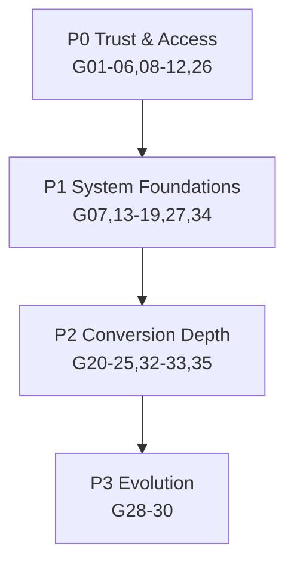

# 10 — Gap Analysis vs Production-Grade Ecommerce Design System

Severity: Critical / High / Medium / Low · Effort: S <1d, M 1–3d, L 1–2w, XL >2w · Priority: P0 now, P1 soon, P2 later, P3 backlog.

| ID | Area | Gap | Evidence | Severity | Business impact | UX impact | Recommendation | Effort | Priority |
|---|---|---|---|---|---|---|---|---|---|
| G-01 | Chrome | No global footer | `premium-footer` imported only in `(shop)/page.tsx` | Critical | Trust loss at every checkout step | Dead-end pages | Move footer into `(shop)/layout.tsx` | S | P0 |
| G-02 | Chrome | ~15 nav/footer links → 404 | `navbar.tsx` menu, `premium-footer.tsx` link arrays | Critical | Trust destruction, support load | Dead ends | Prune links; build /contact,/shipping,/returns,/faq,/categories/kits | M | P0 |
| G-03 | Discovery | No search | `SearchForm` button, no handler/route | Critical | Lost product discovery | Can't find 438 SKUs | Search page + `/api/search` (name/brand/BTU ILIKE) → cmdk dialog | L | P0 |
| G-04 | Auth | Dead Google OAuth buttons | `login-form.tsx:123`, `signup-form.tsx:~253`; no `signInWithOAuth` in actions | Critical | Abandoned signups | Broken promise | Wire OAuth or remove buttons | S | P0 |
| G-05 | Motion | Unstoppable autoplay carousel | `hero-section.tsx:203-210` | Critical | Legal/PR risk | Vestibular harm | Pause control + stopOnInteraction + reduced-motion off | S | P0 |
| G-06 | A11y | CartDrawer not a dialog | `CartDrawer.tsx` raw div | High | Checkout abandonment by AT users | Keyboard/SR trap | Rebuild on `Sheet` | M | P0 |
| G-07 | Tokens | Brand colors not tokenized | 1,651 hardcoded hexes, ~60 files | High | Every future change is a find-replace | Inconsistency | Add `--color-brand-*` ramp; codemod hexes → tokens | L | P0 |
| G-08 | A11y | `#1C99D6` contrast ~3.0:1 | links/CTAs/prices | High | — | Readability, legal | Darken to `#0E7BB0` for text/CTA or use navy CTA | S | P0 |
| G-09 | States | No loading states | 0 `loading.tsx`/Skeleton/`animate-pulse` | High | Perceived slowness → bounce | Frozen UI on SA mobile | `loading.tsx` per route + Skeleton components | M | P0 |
| G-10 | Commerce | No delivery/shipping info | no `/shipping`, no cost line | Critical | #1 abandonment cause for appliances | Uncertainty at pay time | `/shipping` page + checkout delivery line + PDP delivery block (field exists) | M | P0 |
| G-11 | Trust | No payment/security elements at checkout | `CheckoutClient.tsx`; unused `/public/Payments logo/` | High | Payment hesitation | — | Payment method cards w/ logos + EFT explainer + secure copy | S | P0 |
| G-12 | PLP | Fake pagination | `ProductsClient.tsx:298-318` | High | Fake engagement | Dead controls | Real cursor/offset pagination or remove | M | P0 |
| G-13 | Type | Three !important type systems | globals.css:93-213, PDP inline style | High | Fragile overrides | Inconsistent hierarchy | Single token scale in CSS vars; delete overrides | M | P1 |
| G-14 | Tokens | 3 navies / 3 blues / 6 border grays | palette audit | High | Brand dilution | "Off" looking | Consolidate to 1 navy + 1 blue ramp | S (tokens) + L (migration) | P0 |
| G-15 | A11y | No reduced-motion support | zero matches | High | — | Motion sickness | media query + `motion-reduce:` | S | P1 |
| G-16 | A11y | Missing aria-labels | ~6 icon buttons, rating stars, variant groups | Medium | — | SR users | Add labels/roles | S | P1 |
| G-17 | Feedback | Toast wired, never used | `Toaster` mounted; 0 `toast()` calls | Medium | — | No confirmations | toast on add-to-cart, errors, address save | S | P1 |
| G-18 | Forms | No inline validation | checkout relies on native bubbles | Medium | Form errors → abandonment | Confusion | react-hook-form+zod already installed — wire per-field errors | M | P1 |
| G-19 | Forms | Raw `<select>` vs shadcn Select | checkout province/channel | Medium | — | Inconsistent feel | Use Select component or style native consistently | S | P1 |
| G-20 | IA | No account section nav | `account/layout.tsx` = guard only | High | Support burden | Orphan pages | Account sidebar/tabs layout | M | P1 |
| G-21 | IA | `/account` index 404s | no `account/page.tsx` | High | — | Dead route | Add dashboard page | S | P1 |
| G-22 | PDP | Variant chip = full navigation | `router.push` per chip | Medium | Slow option switching | Scroll/gallery reset | Client-side variant state swap (keep URL sync via replace) | M | P1 |
| G-23 | PDP | No reviews section | rating header only | Medium | Lost social proof | — | Reviews block (DB or Trustpilot embed — `/public/trustpilot/` assets exist) | L | P2 |
| G-24 | CRO | No financing/installments | none | Medium | AOV ceiling on R30k items | Affordability | "From RX/month" w/ Payflex/Mobicred/PayJustNow | L | P2 |
| G-25 | Content | Newsletter is fake | `premium-footer.tsx:87` | Medium | Lost list, dark pattern | — | Wire to Supabase/ESP or remove | S | P1 |
| G-26 | Content | Placeholder phone `+27 21 000 0000` | footer | High | Trust | — | Real number | S | P0 |
| G-27 | System | ~17 dead components + dead Navbar/MobileMenu | import graph | Medium | Bundle+confusion | — | Delete dead files | S | P1 |
| G-28 | System | No dark mode (but dead `dark:` classes) | globals.css | Low | — | — | Decide: remove dark: cruft or implement properly | S | P3 |
| G-29 | System | No component docs | no Storybook/docs | Medium | Dev drift | — | Minimal `docs/components.md` or Storybook | M | P2 |
| G-30 | Admin | **Admin UI entirely missing** | `nextadmin-template/` empty | High | Ops can't manage store | — | Separate admin build (out of scope for storefront DS; spec in 14) | XL | P2 |
| G-31 | A11y | Two h1s on PLP; no skip link | `ProductsClient.tsx` | Medium | — | SR/keyboard | Fix heading tree, add skip link | S | P1 |
| G-32 | Checkout | Consent silently disables submit | `CheckoutClient.tsx:301` | Medium | "Why is button dead" | Confusion | Hint text under button / validate on submit instead | S | P1 |
| G-33 | Checkout | Payment radios shown for 1 provider | providers fetch | Low | — | Clutter | Hide selector when `providers.length===1`, show EFT info card instead | S | P1 |
| G-34 | Media | `` vs next/image mixed; spaced folder name | 15 files; `/Hero Images/` | Medium | LCP/bandwidth | Slower loads | Migrate to `next/image`; rename folder | M | P1 |
| G-35 | Analytics | Only purchase event wired | `LeadTracking` only | Medium | Blind funnel | — | view_item/add_to_cart/begin_checkout/search events | M | P2 |

## Gap clusters → roadmap mapping

