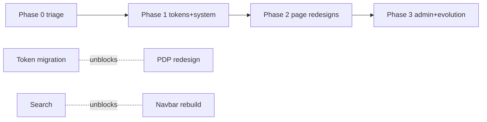

# 16 — Design Remediation Roadmap

Priorities reference gap IDs (`10-gap-analysis.md`) and finding IDs (`findings.csv`).

## Phase 0 — Trust & access triage (Weeks 0–2)

Goal: eliminate every broken promise and unblock the funnel.

| Task | Gaps | Effort |
|---|---|---|
| Global footer in `(shop)/layout.tsx`; prune dead links; point pending pages to a single `/support` hub until built | G-01, G-02 | S–M |
| Fix or remove dead controls: Google OAuth buttons, nav search icon (wire to interim `/search` page or hide), PLP "Get a Quote" CTA | G-03, G-04, C8 | S |
| Hero carousel: pause button, stopOnInteraction/Focus, autoplay off under reduced-motion | G-05 | S |
| Rebuild CartDrawer on `Sheet` (Esc, focus trap, labels) | G-06 | M |
| Tokenize brand ramp + AA-safe interactive blue `#0E7BB0`; codemod worst offenders (checkout, cart, nav, PDP) | G-07, G-08, G-14 | M–L |
| Remove fake pagination OR implement `?page=` pagination | G-12 | M |
| Delivery-cost line + honesty copy in checkout/cart; `/shipping` + `/returns` content pages (or `/support` covering them) | G-10 | M |
| Real contact details; wire or remove newsletter; `/account` dashboard page | G-25, G-26, G-21 | S |
| Route-level `loading.tsx` + Skeleton on PLP/PDP/account | G-09 | M |
| Toast integration: add-to-cart, remove, errors | G-17 | S |

**Exit criteria:** zero 404 links in chrome; zero dead controls; axe scan has no critical violations on PDP/cart/checkout; footer everywhere.

## Phase 1 — Design-system foundations (Weeks 2–6)

| Task | Gaps | Effort |
|---|---|---|
| Full token migration: replace all 1,651 hardcoded hexes; delete Relume namespace + 3 navies | G-07, G-14 | L |
| Type system: single scale, delete `!important` overrides + PDP inline style + `.homepage-typography` | G-13 | M |
| New primitives: Price, Rating, IconButton, EmptyState, ErrorState, VariantSelector, SegmentedControl, Stepper, SearchDialog, TrustBar, OrderSummary, CartLineItem, canonical ProductCard | spec 13 | L |
| Reduced-motion global + `motion-reduce:` on animated components | G-15 | S |
| A11y sweep: aria-labels, radiogroups, rating role, focus styles on raw controls, skip link, single-h1 | G-16, G-31 | M |
| Inline form validation (RHF+zod) + error summary on checkout | G-18 | M |
| Checkout polish: Select components, single-provider card, consent hint, stepper | G-19, G-32, G-33, DS-NAV-008 | M |
| Search: `/api/search` + results page + SearchDialog | G-03 | L |
| Delete dead components (~17 files) + dead Navbar/MobileMenu + Poppins | G-27 | S |
| Images: `next/image` migration, rename `/Hero Images/`, alt conventions | G-34 | M |

**Exit criteria:** hex scan of `src/` returns ~0 outside tokens file; Storybook-or-docs for 15 core components; Lighthouse a11y ≥95.

## Phase 2 — Page redesigns & CRO (Weeks 6–12)

| Task | Gaps | Effort |
|---|---|---|
| Navbar rebuild: 72px, grouped mega-menu, real search, drawer-cart unification | G-03, DS-NAV-004/005 | L |
| PLP: remove oversized hero, applied-filter chips, real pagination, working sort | G-12, PG-02 | M |
| PDP: CTA above add-ons, client-side variant swap, delivery/returns block, sticky mobile ATC | G-22, PG-04 | M |
| Checkout stepped sections + mobile sticky submit + EFT explainer | PG-06 | M |
| Account section nav + dashboard + order detail + reorder | G-20, PG-08/09 | M |
| Reviews on PDP (DB or Trustpilot embed) | G-23 | L |
| Financing/installments messaging | G-24 | L (partner-dependent) |
| Contact/support hub + FAQ | G-02, PG-12 | M |
| Analytics: full funnel events (view_item→purchase, search, filters) | G-35 | M |
| Wishlist / save-for-later | C15 | M |

## Phase 3 — Brand evolution & admin (Quarter 2+)

- Admin build (PG-14/15/16) — XL, possibly separate app on same tokens.
- Dark mode decision (recommended: skip or carefully themed navy-dark).
- Motion refinement pass, branded illustrations, email template design system.
- Personalization (recently viewed, location-based install pricing).
- Component docs → Storybook; visual regression tests.

## Dependency notes

