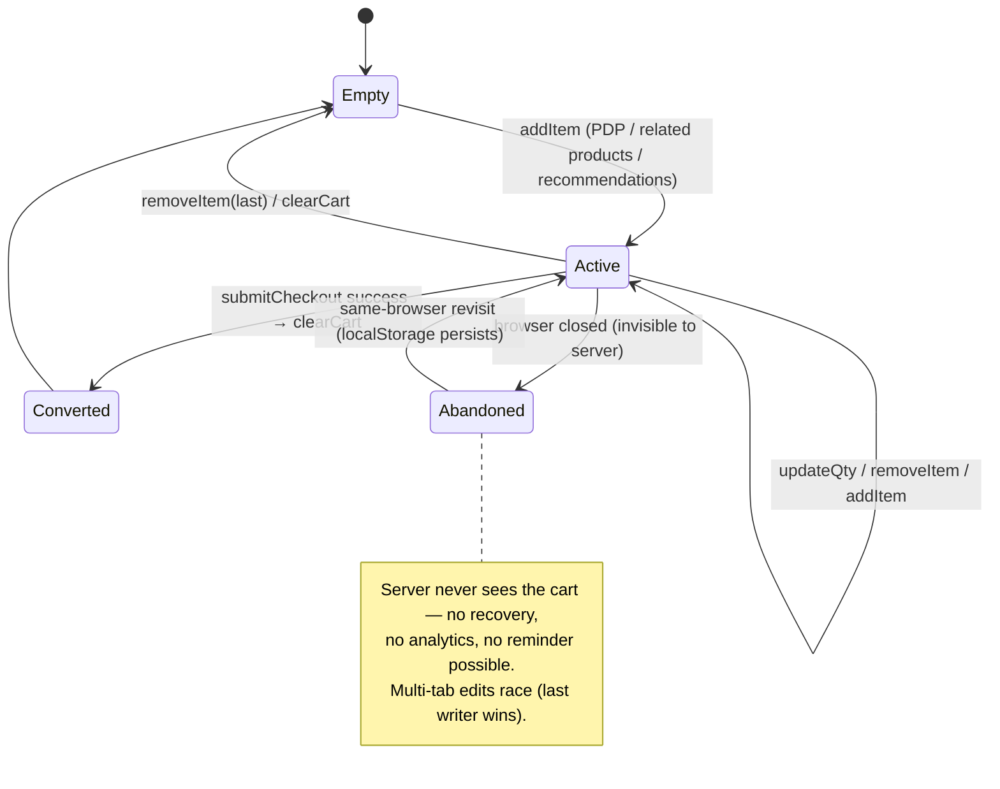
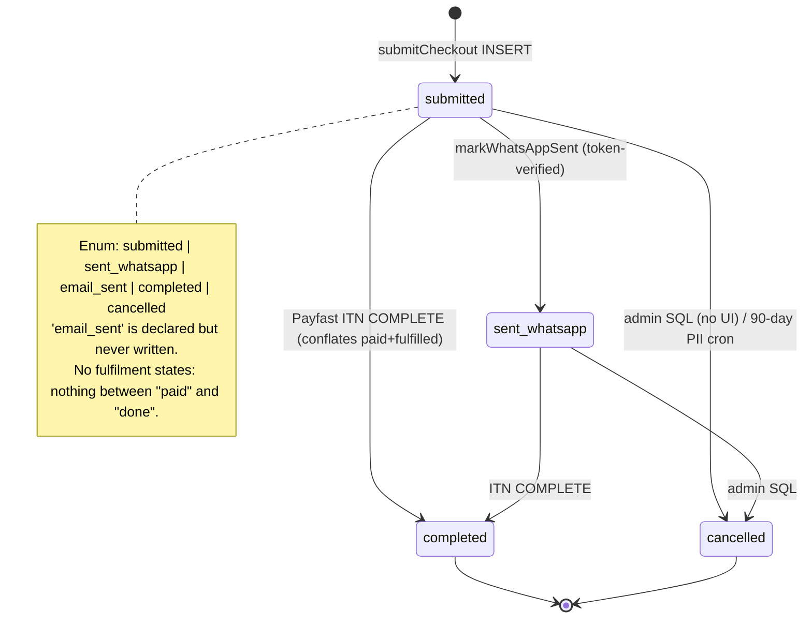
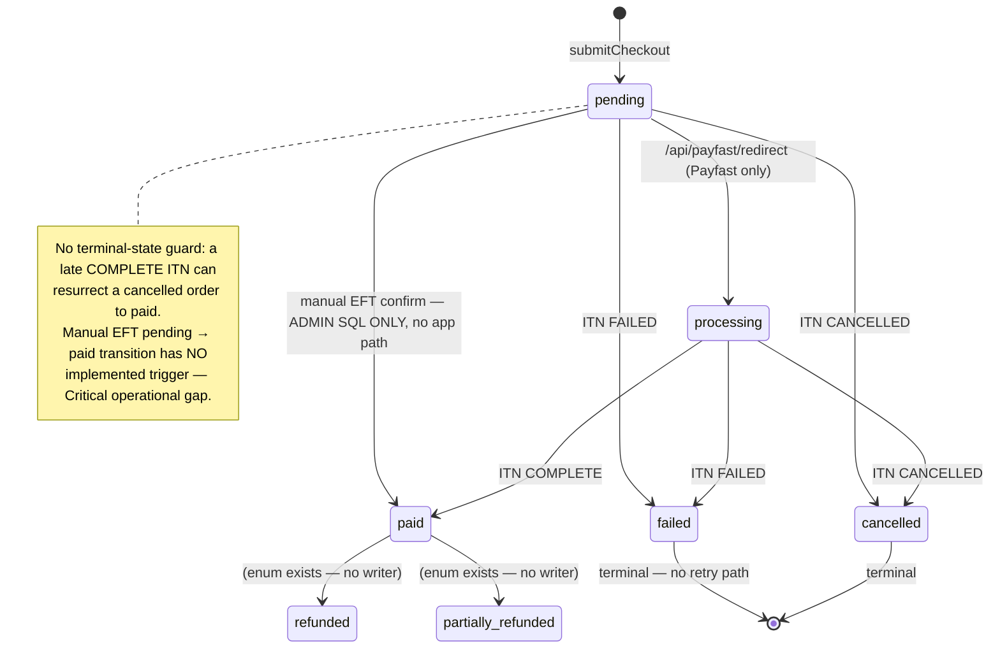
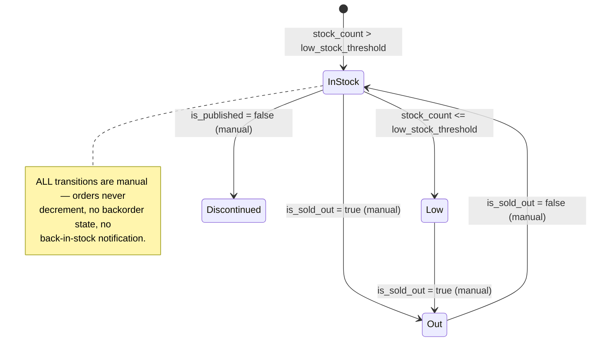

# State Machines (as-implemented)

## E1. Cart state — `localStorage` only

**Gap:** `Abandoned` is observable only to the user's own browser.

## E2. Order state — `orders.status`

## E3. Payment state — `orders.payment_status` (mirror: `payments.status`)

## E4. User state — `auth.users`

```mermaid
stateDiagram-v2
    [*] --> Guest : browse/cart/checkout (no account needed)
    Guest --> Registered : signup (identities>0)
    Registered --> Verified : /auth/callback code exchange
    Registered --> Registered : already-registered → fake success
    Verified --> Active : first login / any login
    Active --> Active : JWT refresh via middleware
    Active --> Guest : signOut
    Active --> Suspended : (no states exist)
    Active --> Deleted : (no self-serve; dashboard admin delete only)
    note right of Registered
        'Verified' is Supabase-managed — app treats
        session as sufficient; orders never link by
        user_id, only by email string match.
    end note
```

## E5. Inventory state — per product row

## Cross-cutting state risks

| Risk | Evidence |
|---|---|
| `status='completed'` conflates "payment received" with "fulfilled" — customer sees "Completed" the moment ITN lands, weeks before installation | `itn/route.ts:108` |
| `orders` ↔ `payments` status pairs updated non-atomically → divergent states possible | `itn/route.ts:102-131`, `redirect/route.ts:68-77` |
| `orders.items` JSONB ↔ `order_items` duplicated sources | `actions.ts:286-351` |
| No terminal guard on ITN replay (cancelled→paid resurrection) | `itn/route.ts:100-160` |
| `expires_at` is a read-gate not a state — expired EFT-paid orders just 404 | `order-confirmed/[token]/page.tsx:126-131` |
