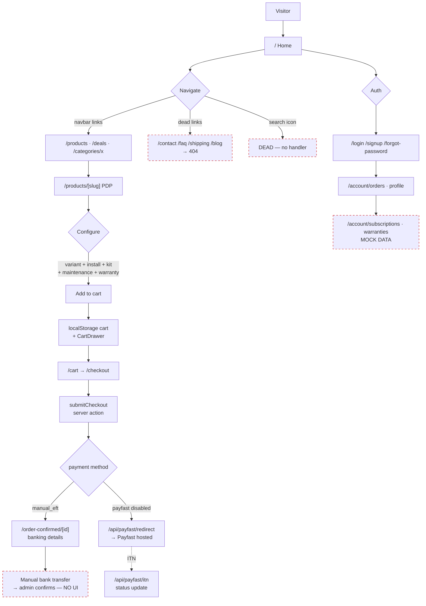
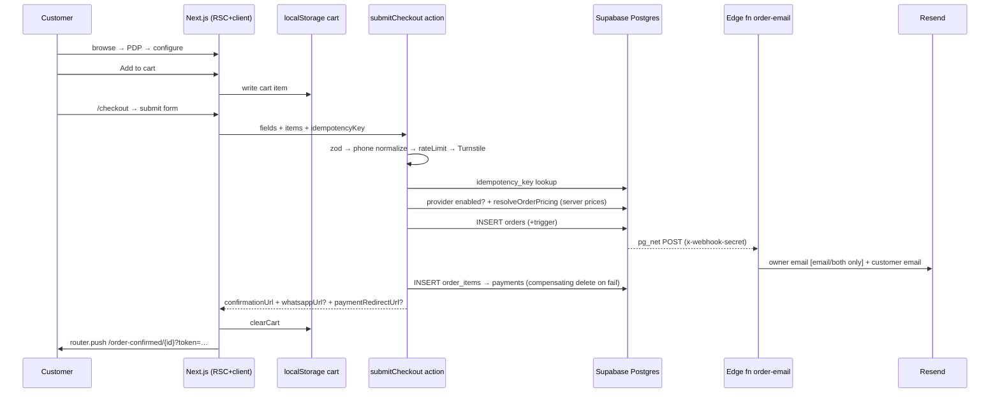
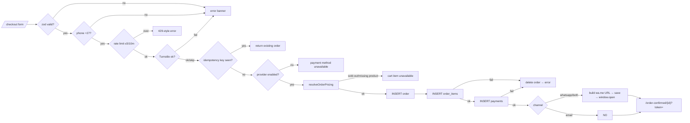
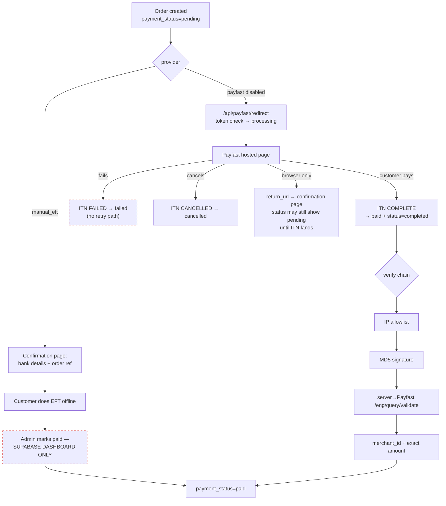
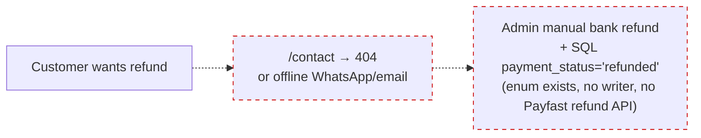
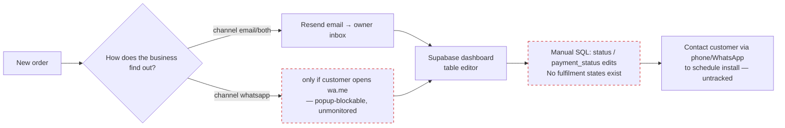
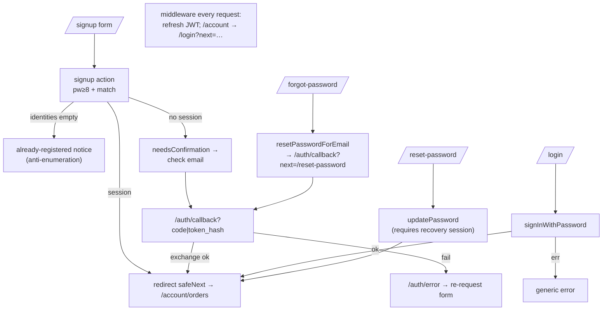
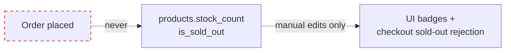
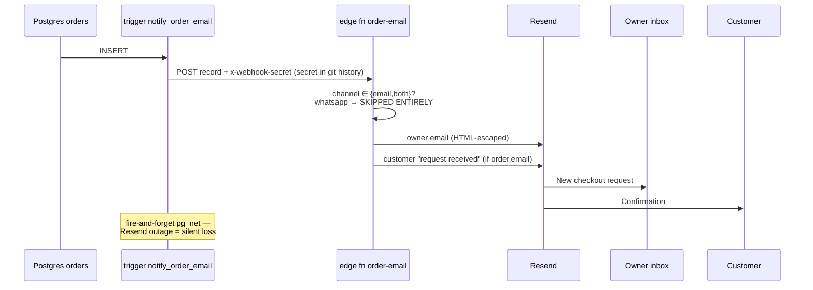
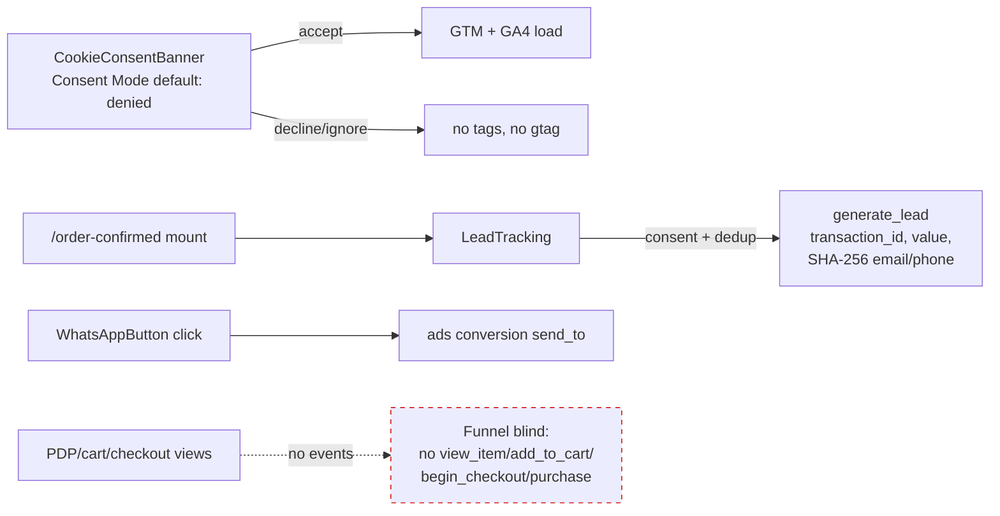

# Flow Diagrams (as-implemented)

All diagrams are evidence-based on the Oct-9 code trace. Dashed lines mark
missing/broken paths.

## 1. High-level user journey map



## 2. Customer purchase flow



## 3. Guest checkout flow



## 4. Account checkout flow — **MISSING**

```mermaid
flowchart TD
    U[Logged-in customer] --> C[/checkout]
    C --> G["Same guest form — no prefill,<br/>no saved addresses, no account linkage"]
    G --> O[Order created with email field only]
    O --> M{"order.email == auth email?"}
    M -->|yes| H["Visible in /account/orders (RLS email match)"]
    M -->|no| O2["Orphaned from account — invisible forever"]
    style O2 stroke:#c00,stroke-dasharray:5 5
```

## 5. Payment flow with success/failure branches



## 6. Refund flow — **MISSING**



## 7. Admin order fulfillment flow — **MISSING (dashboard workaround)**



## 8. Product CRUD flow — **MISSING (dashboard/seed only)**

```mermaid
flowchart LR
    A[Admin] --> B["Supabase table editor /<br/>scripts/seed.ts"]
    B --> P["products (+variants via parent_product_id)<br/>categories / collections / deals"]
    P --> R["RLS: published rows → anon reads"]
    R --> FE[Storefront pages]
    note over B: No validation UI; two coexisting<br/>variant FK behaviours (CASCADE vs SET NULL)
```

## 9. Auth flow (signup, login, reset, verify)



## 10. Cart state machine

See `06-state-machines.md` E1 — `empty → active → converted/abandoned`,
localStorage-only, multi-tab race, invisible to server.

## 11. Order state machine

See `06-state-machines.md` E2 — `submitted → sent_whatsapp|completed|cancelled`;
`email_sent` declared but never written; no fulfilment states.

## 12. Payment state machine

See `06-state-machines.md` E3 — `pending → processing → paid/failed/cancelled`;
`refunded`/`partially_refunded` unreachable; manual-EFT `pending→paid` has no
implemented transition (admin SQL only).

## 13. Inventory sync flow — **MISSING**



## 14. Email notification flow



## 15. Analytics event flow


