# 04 — Dependency Map

Granularity: **stories** (task-level deps are inside stories). ✦ = on critical path.
External blockers in **bold**. `U-xx` = verification unknown from `01`.

## Mermaid — dependency graph

```mermaid
flowchart TD
  subgraph P0["Phase 0 — Stabilize"]
    S11["S-01.1 Commit+deploy fixes ✦"]
    S12["S-01.2 Apply RLS migration ✦"]
    S13["S-01.3 Rotate webhook secret ✦"]
    S14["S-01.4 Prod env verification<br/>(incl. Turnstile + Resend domain)"]
    S15["S-01.5 next@16.3.8"]
    S16["S-01.6 Variant FK check"]
    S17["S-01.7 Rotate GitHub PAT ✦"]
    S18["S-01.8 Trusted-IP rate-limit fix"]
  end

  subgraph P1["Phase 1 — Foundation"]
    S21["S-02.1 Owner notify all channels ✦"]
    S22["S-02.2 settings .single() fix"]
    S23["S-02.3 /admin/orders panel ✦"]
    S31["S-03.1 service_requests pipeline ✦"]
    S81["S-08.1 CI pipeline ✦"]
    S83["S-08.3 env/pkg hygiene"]
    S84["S-08.4 staging env"]
  end

  subgraph P2["Phase 2 — Core flows"]
    S41["S-04.1 Global footer ✦"]
    S42["S-04.2 Link repair +4 pages ✦"]
    S43["S-04.3 Search ✦"]
    S44["S-04.4 Kill dead OAuth"]
    S45["S-04.5 Account IA"]
    S46["S-04.6 Real pagination"]
    S47["S-04.7 OrderHistory controls"]
    S48["S-04.8 Real contact details"]
    S51["S-05.1 Idempotency/session"]
    S53["S-05.3 Expired-link + lookup"]
    S61["S-06.1 Remove fake ratings ✦"]
    S62["S-06.2 Kill mock account pages ✦"]
    S63["S-06.3 Truthful copy"]
    S32["S-03.2 Newsletter persist/remove"]
  end

  subgraph P3["Phase 3 — Harden"]
    S71["S-07.1 Carousel a11y"]
    S72["S-07.2 CartDrawer dialog ✦"]
    S73["S-07.3 Contrast AA ✦"]
    S74["S-07.4 Token consolidation"]
    S75["S-07.5 Labels/semantics"]
    S54["S-05.4 Shipping pricing"]
    S55["S-05.5 VAT/invoice"]
    S56["S-05.6 Checkout UX"]
    S64["S-06.4 POPIA hardening"]
    S82["S-08.2 Sentry+uptime ✦"]
    S85["S-08.5 DR runbook"]
    S86["S-08.6 Security headers"]
    S111["S-11.1 Real unit tests"]
    S113["S-11.3 axe verification"]
    S114["S-11.4 Perf/load"]
  end

  subgraph P4["Phase 4 — Launch gate"]
    S112["S-11.2 Playwright e2e ✦"]
    GATE["UAT + regression + checklist"]
  end

  subgraph P5["Phase 5 — Post-launch"]
    S91["S-09.1 Payfast sandbox E2E"]
    S92["S-09.2 Refund flow"]
    S93["S-09.3 Inventory policy"]
    S24["S-02.4 Status lifecycle"]
    S25["S-02.5 Status emails"]
    S101["S-10.1 Analytics funnel"]
    S102["S-10.2 Coupons (cut? )"]
    S103["S-10.3 SEO fixes"]
    S52["S-05.2 Payfast retry"]
  end

  ACCESS(["PM grants Vercel/Supabase/DNS access"])
  DEC1(["Decisions D1–D10 (week 0)"])
  TAX(["EXT-TAX VAT ruling"])
  NUM(["PM provides real phone/WA/email"])

  ACCESS --> S11 & S12 & S13 & S14 & S16 & S17
  DEC1 --> S61 & S62 & S54 & S93 & S102
  TAX --> S55
  NUM --> S42 & S48
  S14 -->|"Turnstile enabled in prod?"| S18

  S11 --> S12 & S13 & S15 & S21
  S12 --> S31
  S13 --> S21
  S14 --> S84
  S21 --> S23 & S31 & S25
  S23 --> S47 & S24 & S92 & S91
  S31 --> S64
  S81 --> S112
  S84 --> S112 & S114

  S48 --> S42 & S56
  S42 --> S41
  S41 --> S53
  S45 --> S62
  S23 --> S24

  S74 --> S73
  S71 --> S113
  S72 --> S113
  S73 --> S113
  S75 --> S113
  S82 --> GATE
  S111 --> S112
  S112 --> GATE
  S113 --> GATE
  S114 --> GATE
  GATE --> S91
  S91 --> S52
```

## Dependency table

| ID | Task (story) | Depends on | Blocks | Critical? | Owner | Risk |
|----|--------------|-----------|--------|-----------|-------|------|
| S-01.1 | Commit+deploy fixes | Dashboard/Vercel access | 01.2, 01.3, 01.5, 02.1, everything | ✦ | ENG | WIP commit drift |
| S-01.2 | Apply RLS migration | 01.1, Supabase access | — (unblocks spam vector) | ✦ | OPS | Wrong-project apply |
| S-01.3 | Rotate webhook secret | 01.1 | 02.1 (edge fn redeploy) | ✦ | OPS | Trigger+env must change together |
| S-01.4 | Env verification | Access | 08.4, decision inputs | No | ENG+PM | Access delays |
| S-01.5 | next@16.3.8 | 01.1 | — | No | ENG | Minor bump regressions |
| S-01.6 | Variant FK check | Supabase access | follow-up ticket only | No | OPS | — |
| S-01.7 | Rotate GitHub PAT + scrub remote URL | GitHub account access | none (but live credential) | ✦ | OPS | lockout — test new auth before revoking |
| S-01.8 | Trusted-IP rate-limit fix | none (expedite if Turnstile on) | S-08.7 | Conditional | ENG | none — current behavior IS the bug |
| S-02.1 | Owner notify all channels | 01.3 | 02.3, 03.1 | ✦ | ENG | Email template regression |
| S-02.2 | settings `.maybeSingle` | — | — | No | ENG | — |
| S-02.3 | `/admin/orders` | 02.1(soft), admins seed | 04.7, 02.4, 09.x | ✦ | ENG | Auth-bypass — review carefully |
| S-03.1 | service_requests pipeline | 01.2(RLS), 02.1(mail) | 06.4 | ✦ | ENG | New anon-INSERT surface |
| S-03.2 | Newsletter | PM decision | — | No | ENG | — |
| S-04.1 | Global footer | 04.2 (link list) | 05.3 | ✦ | ENG | — |
| S-04.2 | Link repair | Real copy/contact (PM) | 04.1 | ✦ | ENG+PM | Content delays |
| S-04.3 | Search | — | — | ✦(launch-blocking per CF-09) | ENG | FTS index perf trivial |
| S-04.4 | OAuth buttons | PM (default: remove) | — | No | ENG | — |
| S-04.5 | Account IA | 06.2 (which pages survive) | — | No | ENG | — |
| S-04.6 | Pagination | — | — | No | ENG | — |
| S-04.7 | OrderHistory controls | 02.4 status set | — | No | ENG | — |
| S-04.8 | Real contact details | PM supplies numbers | 04.2, 05.6 | ✦(content blocker) | PM | Business input lag |
| S-05.1 | Session idempotency | — | — | No | ENG | — |
| S-05.2 | Payfast retry/cart | — | 09.4 gate | No | ENG | — |
| S-05.3 | Expired-link UX | 04.1 (chrome) | — | No | ENG | Lookup = new attack surface → rate-limit |
| S-05.4 | Shipping pricing | **D3 decision** | — | No | ENG+PM | Decision stall |
| S-05.5 | VAT/invoice | **EXT-TAX ruling** | — | No | ENG+EXT | External lag |
| S-05.6 | Checkout UX | 04.8 | — | No | ENG | — |
| S-05.7 | Cart revalidation | — | — | No | ENG | — |
| S-06.1 | Remove fake ratings | **D5 decision** | — | ✦(compliance) | ENG+PM | Trivial once decided |
| S-06.2 | Mock account pages | **D9 decision** | 04.5 | ✦ | ENG | — |
| S-06.3 | Truthful copy | PM copy review | — | No | PM+ENG | — |
| S-06.4 | POPIA hardening | 03.1 (new PII table) | — | No | ENG | — |
| S-06.5 | Deal-price policy | PM decision | — | No | ENG | — |
| S-07.1 | Carousel a11y | — | 11.3 | No | ENG | — |
| S-07.2 | CartDrawer dialog | — | 11.3 | ✦(AA gate) | ENG | Behavior regressions |
| S-07.3 | Contrast | 07.4 (tokens) preferred | 11.3 | ✦ | DES/ENG | — |
| S-07.4 | Token consolidation | — | 07.3 | No | DES/ENG | Visual regressions ~60 files |
| S-07.5 | Labels/semantics | — | 11.3 | No | ENG | — |
| S-07.6 | Dead-code purge | — | — | No | ENG | — |
| S-08.1 | CI pipeline | GitHub access | 11.2 | ✦ | OPS | — |
| S-08.2 | Sentry+uptime | — | launch gate | ✦ | OPS | — |
| S-08.3 | Env hygiene | — | — | No | OPS | — |
| S-08.4 | Staging | 01.4 | 11.2, 11.4 | No | OPS | Cost (2nd Supabase proj) |
| S-08.5 | DR runbook+drill | 08.4 | launch gate | No | OPS | — |
| S-08.6 | Security headers | — | — | No | ENG | CSP breaks GTM if careless |
| S-09.1 | Payfast sandbox | 02.3, creds | 09.4 | No | ENG | External (Payfast) latency |
| S-09.2 | Refunds | 02.3 | — | No | ENG | — |
| S-09.3 | Inventory policy | **D-inv decision** | — | No | ENG | — |
| S-09.4 | Payfast enable | 09.1+checklist | — | No | ENG | — |
| S-10.1 | Analytics funnel | U-04 answer | — | No | ENG | — |
| S-10.2 | Coupons | PM wants it | — | No | ENG | Cut candidate |
| S-10.3 | SEO fixes | — | — | No | ENG | — |
| S-11.1 | Real unit tests | — | 11.2 | No | ENG | — |
| S-11.2 | Playwright e2e | 08.1, 08.4, 11.1 | launch gate | ✦ | ENG | Flaky tests → CI debt |
| S-11.3 | axe verification | 07.x done | launch gate | ✦ | ENG | — |
| S-11.4 | Perf/load | 08.4 | launch gate | No | ENG | — |
| GATE | UAT+regression | all launch-gate stories | Go-live sign-off | ✦ | PM+ENG | — |

## External blockers (outside ENG control)

| Blocker | Needed by | Owner |
|---|---|---|
| Vercel + Supabase dashboard access | Day 0 (all Phase 0) | PM |
| Real phone / WhatsApp / email / hours | Week 3 (S-04.8 → blocks footer+contact+copy) | PM |
| VAT ruling | Week 7 (S-05.5) | EXT-TAX |
| Decisions D1–D10 | Week 0–2 (gate S-06.1/06.2/05.4/09.3/10.2) | PM |
| Payfast sandbox merchant creds | Week 12 (S-09.1) | PM + Payfast |
| Legal review of terms/privacy/CPA posture | Week 8 | EXT-LEGAL |

## Decision points (stall risks)

1. **D3 shipping model** — gates S-05.4 (8h vs 20h implementations).
2. **D5 ratings** — removal is 2h; "real reviews" is a whole epic. Decide removal now, reviews later.
3. **D6 Payfast** — if EFT-only forever, EPIC-09 shrinks to refunds+inventory.
4. **D-inv** — enforcement vs honesty-copy changes both checkout and PDP.
5. **D-deal** — honor deal price vs honest labeling.

## Spikes required before estimating firmly

- **SP-1 (in S-01.4):** prod env + RLS + gtag verification — 3h, gates CI/staging scope.
- **SP-2 (in S-01.6):** prod variant FK — 1h.
- **SP-3:** token migration blast radius (S-07.4) — 2h grep+codemonk pass to confirm ~60-file estimate before committing to it. **UNVERIFIED — needs spike** label stands.

## Sequencing risks

- Doing 07.4 (tokens) before 04.1/04.2 doubles footer work — build new chrome on tokens OR accept one restyle pass.
- Admin panel (02.3) is on the critical path for 4 downstream stories; slipping it stalls Phase 5 wholesale.
- e2e suite (11.2) depends on staging (08.4) which depends on env audit (01.4) — an access delay cascades to the launch gate.
- Search (04.3) is marked launch-blocking; if cut, the dead icon must still be removed — the finding is "dead control", not "must build search". Decision needed: build FTS vs remove icon.
