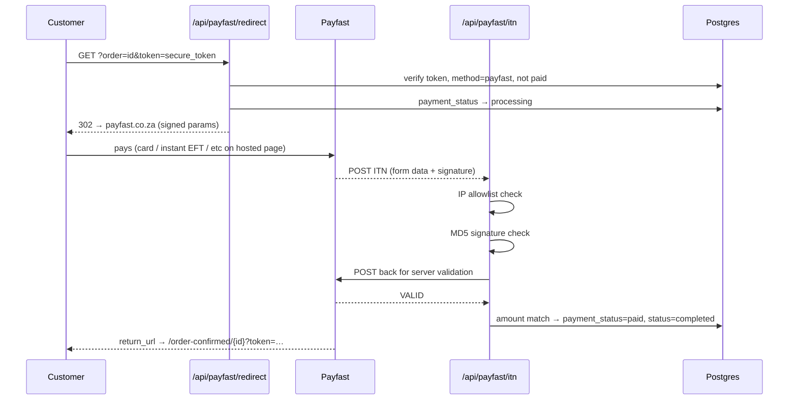

# 05 — Payment Architecture (As-Is)

## Context diagram

```mermaid
flowchart LR
    CUST[Customer browser] -->|guest checkout form| SA[submitCheckout server action]
    SA -->|Upstash REST, optional| REDIS[(Upstash Redis\nrate limit)]
    SA -->|siteverify, optional| TS[Cloudflare Turnstile]
    SA -->|service role| DB[(Supabase Postgres\norders / order_items /\npayments / payment_providers)]
    SA -->|wa.me deep link| WA[WhatsApp → business]
    DB -->|pg_net trigger on INSERT| EF[Edge Function\norder-email]
    EF -->|RESEND_API_KEY| RES[Resend API]
    RES --> OWNER[Owner inbox]
    RES --> CUSTEMAIL[Customer email]

    SA -->|payfast only: redirect URL| CUST
    CUST -->|GET /api/payfast/redirect?order&token| PR[/payfast/redirect route/]
    PR -->|service role| DB
    PR -->|302 → payfast.co.za| PF[Payfast hosted page]
    CUST -->|pay on hosted page| PF
    PF -->|POST ITN form-data| ITN[/api/payfast/itn route/]
    ITN -->|server-to-server validate| PFV[Payfast /eng/query/validate]
    ITN -->|service role: update orders+payments| DB
    PF -->|return_url| OC[/order-confirmed/[id]?token=secure_token/]
    OC -->|service role read| DB
```

## Sequence — Manual EFT (the only enabled method)

```mermaid
sequenceDiagram
    participant C as Customer
    participant A as submitCheckout
    participant DB as Postgres
    participant W as WhatsApp/Email
    participant ADM as Admin (DB console)

    C->>A: submit checkout (EFT, consent, items)
    A->>A: rateLimit (opt) + Turnstile (opt) + idempotency check
    A->>DB: resolveOrderPricing (server-side)
    A->>DB: INSERT order (status=submitted, payment_status=pending)
    A->>DB: INSERT order_items; INSERT payment (pending)
    DB-->>EF: trigger on INSERT → order-email
    EF->>W: owner + customer email (Resend)
    A-->>C: confirmation URL + wa.me link
    C->>W: opens WhatsApp → markWhatsAppSent (status=sent_whatsapp)
    Note over C,ADM: Customer does bank transfer manually.<br/>Admin matches bank deposit to order_number<br/>and manually edits payment_status in DB.
    ADM->>DB: UPDATE orders SET payment_status='paid' (manual, unaudited)
```

## Sequence — Payfast (implemented, disabled)



## Component inventory

| Component | File | Notes |
|---|---|---|
| Provider interface | `src/lib/payment/types.ts` | createPayment + verifyWebhook |
| Registry | `src/lib/payment/registry.ts` | static map, populated by side-effect imports |
| Provider loader | `src/lib/payment/provider.ts` | + `getEnabledProviders()` (DB) |
| Payfast | `src/lib/payment/payfast.ts` | redirect + MD5 sig + ITN verify + server validation |
| Manual EFT | `src/lib/payment/manual-eft.ts` | redirect-only, no webhook |
| Checkout action | `src/app/(shop)/checkout/actions.ts` | validation, pricing, order+payment insert, WhatsApp |
| Providers fetch | `src/app/(shop)/checkout/providers-action.ts` | enabled providers for the UI |
| Payfast redirect | `src/app/api/payfast/redirect/route.ts` | token-gated 302 to hosted page |
| Payfast ITN | `src/app/api/payfast/itn/route.ts` | IP allowlist → verify → amount match → status update |
| Order confirmation | `src/app/order-confirmed/[token]/page.tsx` | token+expiry gated; banking details; Pay button for pending payfast |
| Order email | `supabase/functions/order-email/index.ts` | INSERT-triggered, secret-authed, Resend |
| Client tracking | `order-confirmed/[token]/LeadTracking.tsx` | gtag generate_lead, sessionStorage dedup |

## Design strengths

1. **Server-side price resolution** — client sends config only; prices re-derived from DB.
2. **Defence-in-depth ITN** — signature + server validation + IP allowlist + merchant +
   exact-amount match. Hard to forge a "paid".
3. **DB-level idempotency** — unique partial index on `orders.idempotency_key`.
4. **Compensating deletes** on partial order-insert failure.
5. **Token-gated order reads** — UUID + secure_token + 48h expiry (EFT exempt).
6. **Provider registry** — clean seam for new gateways.

## Design weaknesses

1. Payment and fulfilment conflated into one status set (PAY-01).
2. No event sourcing — `provider_response` is last-write-wins.
3. Provider enablement is DB-driven but checkout method enum is hardcoded.
4. Two `orders.items` representations (JSONB blob + `order_items` rows) — can diverge.
5. No admin surface — all operational payment actions are raw SQL.
6. Optional defences (rate limit, Turnstile) fail open silently.
