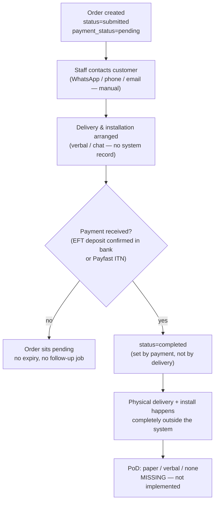

# 06 — Delivery Architecture (As-Is)

## The honest diagram

There is no delivery architecture to diagram. The "system" is a confirmation page that says
*"we will contact you to arrange delivery and installation"* plus a WhatsApp message to the
business containing the order details (`actions.ts:92-131`).

## What a delivery request actually produces today

| Data captured | Where | Type |
|---|---|---|
| Street address | `orders.delivery_address` | free text, min 5 chars |
| City | `orders.delivery_city` | free text, min 2 chars |
| Province | `orders.delivery_province` | free text, optional |
| Installation notes | `orders.installation_notes` | free text |
| Delivery/installation request | `order_items.has_installation`, `installation_tier_id`, `kit_configuration` | priced options |

Everything else about fulfilment — date, crew, vehicle, route, ETA, outcome, PoD — lives
in phone calls and WhatsApp threads outside the system.

## Gaps vs a minimal fulfilment loop

```mermaid
flowchart LR
    subgraph EXISTS
        A[Order + address] --> B[Manual contact]
    end
    subgraph MISSING["MISSING — not implemented"]
        C[Zone/service-area check] -.-> D[Delivery quote/pricing]
        D -.-> E[Scheduling & slot]
        E -.-> F[Driver/crew assignment]
        F -.-> G[Dispatch notification]
        G -.-> H[En-route tracking/ETA]
        H -.-> I[Proof of delivery]
        I -.-> J[Completion + receipt]
        J -.-> K[Failed-delivery loop]
    end
    B -.->|no data path| C
```

## Operational reality (assumption — labelled)

> ASSUMPTION: fulfilment today is "office phone/WhatsApp the customer, send the install
> crew, collect the balance in person or confirm EFT cleared". This is workable at low
> volume but means: no charge is enforced for delivery, no record exists if the customer
> disputes delivery, no way to prove an installer visited, and no way to measure delivery
> performance.

## Risk register

| Risk | Severity | Why |
|---|---|---|
| Delivered-but-unpaid goods | **Critical** | Nothing links physical handover to `payment_status`; an installer can deliver on a pending EFT order with no system check. |
| Delivery-fee leakage | High | No delivery charge field — every order is structurally free delivery. |
| Undeliverable orders | High | No address validation, zones, or postcodes. |
| "Where is my order?" load | High | No tracking page/notifications — all WISMO goes to phone/WhatsApp. |
| Dispute with no PoD | High | Signed PoD absent — instalments of R20k+ goods with no delivery evidence. |
| Crew scheduling collisions | Medium | No calendar/dispatch tooling. |
