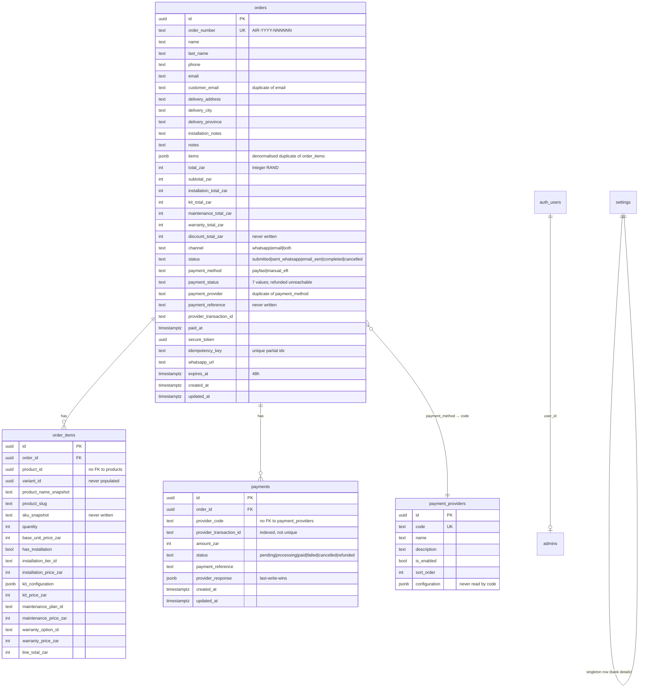

# 07 — Data Model Audit

## Existing ERD (payment/delivery-relevant tables)

## Issues

| ID | Sev | Issue | Evidence |
|---|---|---|---|
| DM-01 | High | **Two divergent order-item representations**: `orders.items` JSONB (written at checkout, used by confirmation page + email) vs `order_items` rows (used by account page). They can silently disagree; the email trigger reads the JSONB. | `actions.ts:286-300, 333-351`; `order-email/index.ts` |
| DM-02 | High | No `deliveries`/`delivery_events`/`drivers`/… — see 02-delivery-audit | — |
| DM-03 | Medium | `orders.status` and `orders.payment_status` overlap semantically (`completed` means paid; `cancelled` exists in both). No canonical order state. | CHECK constraints |
| DM-04 | Medium | `orders.email` and `orders.customer_email` are both written with the same value — redundant; customer-order RLS checks both, doubling confusion | `actions.ts:279-280`; `20260917b` |
| DM-05 | Medium | `payments.provider_code` is free text — no FK to `payment_providers.code`; typos create orphan records | DDL `:134` |
| DM-06 | Medium | `payments.provider_transaction_id` indexed but **not unique** — duplicate ITNs can create conflicting records once more writers exist | `:146` |
| DM-07 | Medium | Amounts are integer **rand** (not cents) — `total_zar integer`. No currency column anywhere; ZAR is implied. Multi-currency or cents would be a breaking change. | `:27`, `:136` |
| DM-08 | Medium | `orders.payment_reference` and `order_items.sku_snapshot`/`variant_id` columns exist but are never written — dead columns signalling unfinished work | grep: `payment_reference` written only on `payments` |
| DM-09 | Medium | `orders.items` JSONB is wiped by the 90-day PII cron (`items='[]'`) — destroying the only item detail on orders where… actually only `status='submitted'` orders are anonymised, so paid orders keep both copies forever. Inconsistent retention. | `20260710085327:91-101` |
| DM-10 | Low | No `currency` column, no `payment_events`, no `refunds`, no `delivery*` tables, no `audit_log` | — |
| DM-11 | Low | `product_id`/`variant_id` in `order_items` have no FK to `products` — snapshots are the intent, but FK-less columns still allow orphan analysis confusion | DDL `:96-97` |
| DM-12 | Info | `secure_token` is a `uuid` with index — adequate entropy (122 bits) for a bearer token; 48h expiry limits window | `:81` |

## Storage-per-order estimate (for sizing model)

| Object | Bytes (approx) |
|---|---|
| `orders` row | ~1.5 KB (PII + address + status fields) |
| `orders.items` JSONB | ~1–3 KB (avg 1.5 items) |
| `order_items` rows | ~0.8 KB × 1.5 avg |
| `payments` row + provider_response | ~2 KB |
| **Total per order (today)** | **~6–8 KB** |
| + to-be payment_events (avg 4) | +3 KB |
| + to-be delivery + events (avg 8) + PoD metadata | +5 KB |
| + PoD photo (Supabase Storage) | +300–800 KB (object storage, not DB) |
