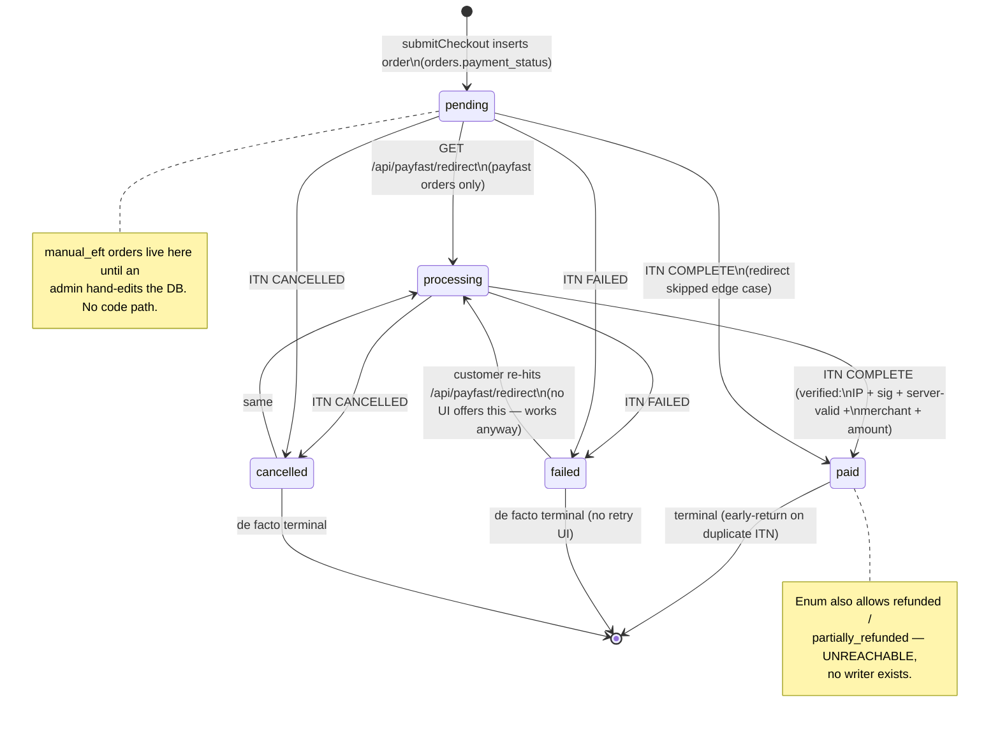
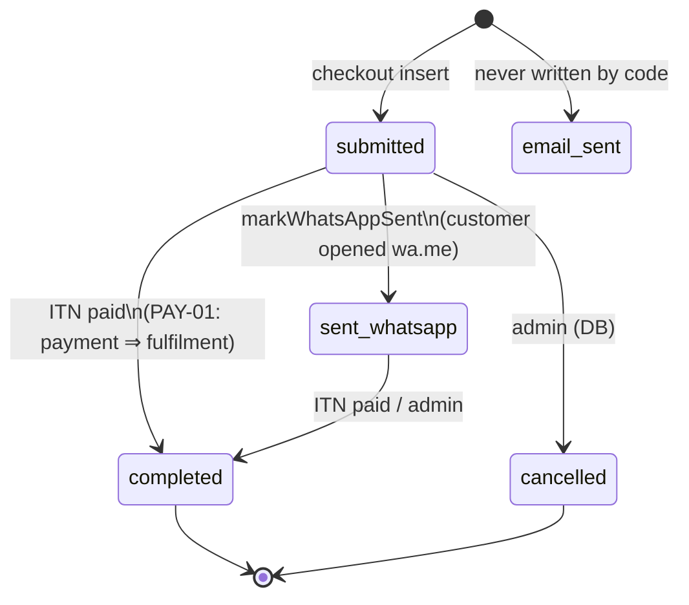
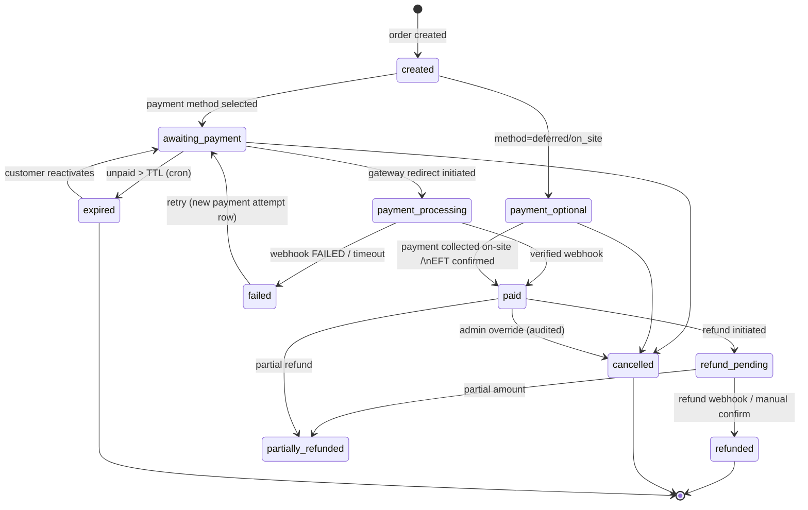

# 11 — Payment State Machine

## As-is (actual, evidence-derived)

### orders.status (parallel, conflated)

### Transition enforcement

**None.** Transitions are just `UPDATE`s; any enum value can follow any other. The only
guards in code: ITN ignores notifications for already-`paid` orders; redirect refuses
already-`paid` orders.

## To-be (target for TRD)

Rules the to-be machine enforces (currently absent):

- Single writer per transition via an `order_events`/`payment_events` append-only table —
  status is *derived* from events, not stored as truth.
- Terminal states: `refunded`, `cancelled`, `expired` are final; only admins can override,
  and overrides emit an event with actor identity.
- Every transition emits a notification hook (email/WhatsApp) and a metrics counter.
- `provider_transaction_id` unique per payment attempt → webhook dedup is structural.
- Order `status` (fulfilment) and `payment_status` are separate machines joined at
  `order_id`; payment never writes fulfilment status directly.
