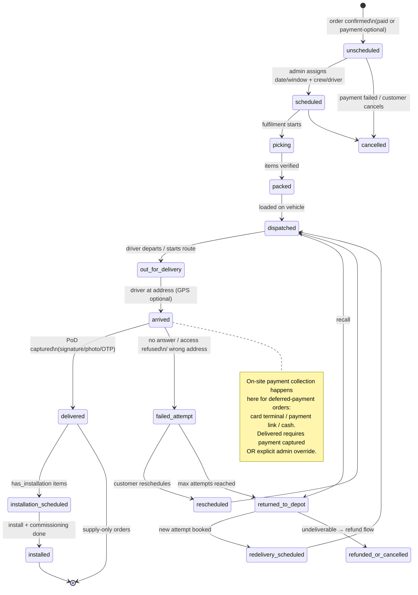

# 12 — Delivery State Machine

## As-is

**MISSING — not implemented.** There is no delivery entity, so there is no state machine.
The closest thing is `orders.status`, where `completed` is set by *payment* — see
`11-payment-state-machine.md` and PAY-01/DEL-02.

## To-be (target for TRD)

### Actor matrix (to-be)

| Transition | Triggered by | Notification emitted |
|---|---|---|
| → scheduled | dispatcher/admin | SMS/email: date + window |
| → dispatched | dispatcher | "on the way" + tracking link |
| → out_for_delivery | driver app | ETA update |
| → arrived | driver app (GPS-suggested) | — |
| → delivered | driver app + PoD artefact | receipt + invoice |
| → failed_attempt | driver app + reason code | reschedule prompt to customer |
| → installed | installer + commissioning checklist | completion + warranty docs |
| → cancelled/refunded_or_cancelled | admin (audited) | refund status |

### Hard rules

1. `delivered` **requires** a `proof_of_delivery` row (signature XOR photo XOR OTP-verified).
2. `delivered` on a `payment_deferred` order **requires** a captured `payment_collection`
   or admin override — this is the control that answers "what prevents unpaid goods being
   delivered without payment".
3. Max delivery attempts (config, default 2) → `returned_to_depot` → refund/dedupe flow.
4. Every transition writes `delivery_events` (append-only: actor, timestamp, GPS, note).
5. Customer-facing status vocabulary maps to: `processing → scheduled → on its way →
   delivered/installed` — never expose internal codes raw.
